<div align="center">


<a href="https://readme-typing-svg.demolab.com/"></a>

<p>
<a href="https://github.com/mhmdhmdbdh2050"></a>
<a href="https://www.linkedin.com/in/mohamed-ahmed-6705b3303/"></a>
<a href="mailto:ahmedmohamed05147@gmail.com"></a>
</p>

</div>


## 👋 About Me

I'm **Mohamed Ahmed Abdo**, based in **Giza, Egypt**. I learn DevOps by building practical environments and debugging them hands-on. My projects explore containerized application stacks, Docker networking and persistent storage, and Kubernetes workloads exposed through Ingress.

I'm looking for opportunities as a **Junior DevOps Engineer** or **Junior Cloud Engineer**.

### Terminal Snapshot

```bash
$ whoami
Mohamed Ahmed Abdo — Junior DevOps & Cloud Engineer

$ focus
Linux • Docker • Kubernetes • AWS • Automation • Networking

$ approach
Build → Test → Troubleshoot → Document → Improve
```


## 🧩 Technical Toolkit


**Hands-on areas:** Docker Compose, Docker networks and volumes, Kubernetes Deployments and Services, NGINX Ingress, ConfigMaps and Secrets fundamentals, Jobs and CronJobs, scheduling concepts, AWS EC2 and VPC labs.

> The technologies above reflect my learning and practical labs. I distinguish hands-on projects from professional production experience.


## 🧭 DevOps Learning Roadmap

```mermaid
flowchart LR
    A[🐧 Linux & Bash] --> B[🔀 Git & GitHub]
    B --> C[🐳 Docker & Compose]
    C --> D[☁️ AWS Fundamentals]
    D --> E[☸️ Kubernetes]
    E --> F[🔐 Security & RBAC]
    F --> G[⚙️ CI/CD & Observability]
    style A fill:#176b87,color:#fff,stroke:#2DD4BF
    style B fill:#176b87,color:#fff,stroke:#2DD4BF
    style C fill:#176b87,color:#fff,stroke:#2DD4BF
    style D fill:#176b87,color:#fff,stroke:#2DD4BF
    style E fill:#A66B15,color:#fff,stroke:#FF9900
    style F fill:#5B4B9A,color:#fff,stroke:#A78BFA
    style G fill:#5B4B9A,color:#fff,stroke:#A78BFA
```



- **Solid foundation:** Linux & Bash, Git & GitHub, Docker & Compose, AWS Fundamentals
- **In progress:** Kubernetes
- **Next:** Security & RBAC, CI/CD & Observability

*This is a learning roadmap, not a claim of mastery.*


## 🏅 AWS Certifications

<a href="https://aws.amazon.com/verification/"></a>

<a href="https://aws.amazon.com/verification/"></a>

Verify credentials through the official [AWS Certification Verification](https://aws.amazon.com/verification/) page using the validation number printed on each certificate.


## 🚀 Featured Projects

<a href="https://github.com/mhmdhmdbdh2050/k8s-multi-app-ingress-lab"></a>

A multi-app Kubernetes lab on AWS EC2 using NGINX Ingress path-based routing.

- Deployments and Services
- Ingress routing and troubleshooting
- Flannel networking and scheduling concepts

<a href="https://github.com/mhmdhmdbdh2050/devops-automation-stack"></a>

A Docker Compose environment with Flask, PostgreSQL, Redis, and Nginx.

- Multi-container orchestration and persistent storage
- Health checks and service dependencies
- Backup/restore and automation scripts

<a href="https://github.com/mhmdhmdbdh2050/docker-compose-wordpress-stack"></a>

A WordPress multi-container setup using Docker Compose, MariaDB, Nginx, and phpMyAdmin.

<a href="https://github.com/mhmdhmdbdh2050/Docker-networking-lab"></a>

A focused lab for bridge networks, network isolation, static IP addressing, and multi-network containers.

### More Projects

- [Docker Custom Image](https://github.com/mhmdhmdbdh2050/Docker-custom-image-project) — Dockerfile, custom Nginx image, and port mapping.
- [Docker Volume Project](https://github.com/mhmdhmdbdh2050/Docker-volume-project) — persistent container storage.
- [Simple Docker Project](https://github.com/mhmdhmdbdh2050/Simple_docker_project) — serving a website from a container.


## 📊 GitHub Activity

<div align="center">


</div>

*GitHub statistics and third-party widgets are provided by external services and may occasionally be unavailable or delayed.*


## 🎓 Education

**Cairo University — Faculty of Commerce**  
Graduated: 2026

## 🤝 Contact

- **Email:** [ahmedmohamed05147@gmail.com](mailto:ahmedmohamed05147@gmail.com)
- **LinkedIn:** [linkedin.com/in/mohamed-ahmed-6705b3303](https://www.linkedin.com/in/mohamed-ahmed-6705b3303/)
- **GitHub:** [github.com/mhmdhmdbdh2050](https://github.com/mhmdhmdbdh2050)

<div align="center">

</div>
