<div align="center">


<a href="https://readme-typing-svg.demolab.com/">
  
</a>

<p>
  <a href="https://github.com/mhmdhmdbdh2050"></a>
  <a href="https://www.linkedin.com/in/mohamed-ahmed-6705b3303/"></a>
  <a href="mailto:ahmedmohamed05147@gmail.com"></a>
</p>

<p>
  
  
</p>

</div>

---

## 👋 About Me

```bash
$ whoami
Mohamed Ahmed Abdo — Junior DevOps & Cloud Engineer

$ focus
Linux • Docker • Kubernetes • AWS • Automation • Networking

$ approach
Build → Test → Troubleshoot → Document → Improve
```

I'm based in **Giza, Egypt**, and I learn DevOps by building practical environments and debugging them hands-on. My projects explore containerized application stacks, Docker networking and persistent storage, and Kubernetes workloads exposed through Ingress.

I'm looking for opportunities to grow as a **Junior DevOps Engineer or Junior Cloud Engineer**, contribute to a team, and keep improving my infrastructure and automation skills.

## 🛠️ Tech Stack

<div align="center">

### Linux & Automation


### Containers & Orchestration


### Cloud & Application Services


</div>

**Hands-on areas:** Docker Compose · Docker networks and volumes · Kubernetes Deployments and Services · NGINX Ingress · ConfigMaps and Secrets fundamentals · Jobs and CronJobs · Scheduling concepts · AWS EC2 and VPC labs.

> The technologies above reflect my learning and practical labs. I distinguish hands-on projects from professional production experience.

---

## 🧭 My DevOps Learning Roadmap

```mermaid
flowchart LR
    A[🐧 Linux & Bash] --> B[🔀 Git & GitHub]
    B --> C[🐳 Docker & Compose]
    C --> D[☁️ AWS Fundamentals]
    D --> E[☸️ Kubernetes]
    E --> F[🔐 Security & RBAC]
    F --> G[⚙️ CI/CD & Observability]
    style A fill:#176b87,color:#fff,stroke:#2dd4bf
    style B fill:#176b87,color:#fff,stroke:#2dd4bf
    style C fill:#176b87,color:#fff,stroke:#2dd4bf
    style D fill:#176b87,color:#fff,stroke:#2dd4bf
    style E fill:#a66b15,color:#fff,stroke:#f0b44d
    style F fill:#a66b15,color:#fff,stroke:#f0b44d
    style G fill:#5b4b9a,color:#fff,stroke:#a78bfa
```



**Roadmap note:** Linux, Docker, AWS fundamentals, and multiple Kubernetes workloads have been practised through labs. Kubernetes security/RBAC, CI/CD, and observability remain areas for continued development; the diagram is a learning roadmap, not a certification of mastery.

---

## 🏅 AWS Certifications

<div align="center">


</div>

| Certification | Issue date | Expiration |
|---|---|---|
| **AWS Certified AI Practitioner** | September 10, 2026 | September 10, 2029 |
| **AWS Certified Cloud Practitioner** | May 25, 2026 | May 25, 2029 |

Both certificates include AWS validation numbers. Use the official [AWS Certification Verification](https://aws.amazon.com/verification/) page to verify them.

---

## 🚀 Featured Projects

<table>
<tr>
<td width="50%" valign="top">

### ☸️ Kubernetes Multi-App Ingress Lab

Multi-application Kubernetes lab on AWS EC2, focused on exposing workloads through NGINX Ingress path-based routing.

**What it demonstrates**
- Deployments and Services
- Ingress routing and troubleshooting
- Flannel cluster networking
- Scheduling and workload concepts

[**View repository →**](https://github.com/mhmdhmdbdh2050/k8s-multi-app-ingress-lab)

</td>
<td width="50%" valign="top">

### ⚙️ DevOps Automation Stack

A Docker Compose application environment connecting Flask, PostgreSQL, Redis, and Nginx.

**What it demonstrates**
- Multi-container orchestration
- Persistent database storage
- Health checks and dependencies
- Backup/restore and automation scripts

[**View repository →**](https://github.com/mhmdhmdbdh2050/devops-automation-stack)

</td>
</tr>
<tr>
<td width="50%" valign="top">

### 🐳 Dockerized WordPress Stack

A multi-container WordPress setup for practising application services, networking, and persistent data.

**Stack:** WordPress · MariaDB · Nginx · phpMyAdmin · Docker Compose

[**View repository →**](https://github.com/mhmdhmdbdh2050/docker-compose-wordpress-stack)

</td>
<td width="50%" valign="top">

### 🌐 Docker Networking Lab

A focused lab exploring how Docker containers communicate and how custom networks provide isolation.

**Focus:** Bridge networks · Network isolation · Static IP addressing · Multi-network containers

[**View repository →**](https://github.com/mhmdhmdbdh2050/Docker-networking-lab)

</td>
</tr>
</table>

### More projects

| Project | Focus | Repository |
|---|---|---|
| Docker Custom Image | Dockerfile, custom Nginx image, port mapping | [View →](https://github.com/mhmdhmdbdh2050/Docker-custom-image-project) |
| Docker Volume Project | Persistent container storage | [View →](https://github.com/mhmdhmdbdh2050/Docker-volume-project) |
| Simple Docker Project | Serving a website from a container | [View →](https://github.com/mhmdhmdbdh2050/Simple_docker_project) |

---

## 📊 GitHub Activity

<div align="center">


</div>

*Stats and third-party widgets are provided by external services and may occasionally be unavailable or delayed.*

---

## 🎓 Education

**Cairo University — Faculty of Commerce**  
Graduated: 2026

---

## 🤝 Let's Connect

I'm interested in junior DevOps and Cloud opportunities, collaborative projects, and exchanging practical technical knowledge.

<div align="center">

<a href="mailto:ahmedmohamed05147@gmail.com"></a>
<a href="https://www.linkedin.com/in/mohamed-ahmed-6705b3303/"></a>
<a href="https://github.com/mhmdhmdbdh2050"></a>

*"Automate what you can. Understand what you build. Document what you learn."*


</div>
