


## `01` — About Me

I'm **Mohamed Ahmed Abdo**, a **Junior DevOps & Cloud Engineer** based in **Giza, Egypt**.

I learn DevOps by building practical environments and debugging them hands-on. I'm looking for opportunities as a Junior DevOps Engineer or Junior Cloud Engineer.

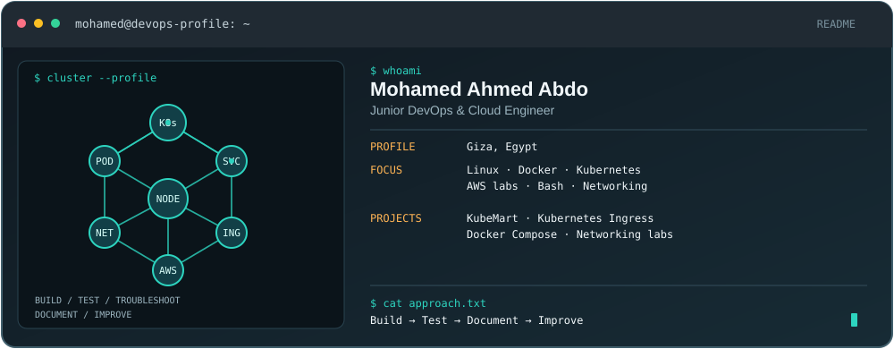

## `02` — Technical Architecture

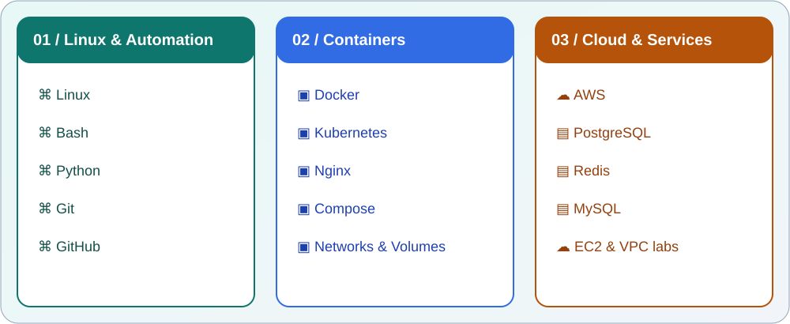

**Hands-on areas:** Docker Compose, Docker networks and volumes, Kubernetes Deployments and Services, NGINX Ingress, ConfigMaps and Secrets fundamentals, Jobs and CronJobs, scheduling concepts, AWS EC2 and VPC labs.

> The technologies above reflect my learning and practical labs. I distinguish hands-on projects from professional production experience.

## `03` — Engineering Roadmap

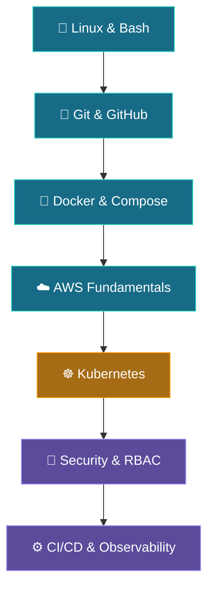

- **Solid foundation:** Linux & Bash → Git & GitHub → Docker & Compose → AWS Fundamentals.
- **In progress:** Kubernetes.
- **Next:** Security & RBAC, followed by CI/CD & Observability.

*This is a learning roadmap, not a claim of mastery.*

## `04` — Certifications

<a href="https://aws.amazon.com/verification/">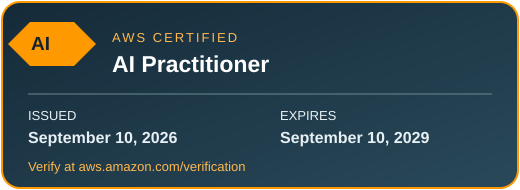</a>

<a href="https://aws.amazon.com/verification/">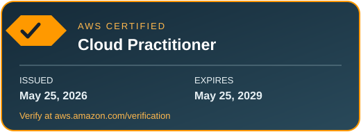</a>

Verify certificates using the official [AWS Certification Verification](https://aws.amazon.com/verification/) service and the validation number printed on each credential.

## `05` — Selected Projects

<a href="https://github.com/mhmdhmdbdh2050/k8s-multi-app-ingress-lab">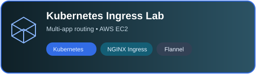</a>

**Kubernetes Multi-App Ingress Lab**

A multi-application Kubernetes lab on AWS EC2, featuring NGINX Ingress path-based routing.

- Deployments and Services.
- Ingress routing and troubleshooting.
- Flannel networking and scheduling concepts.

<a href="https://github.com/mhmdhmdbdh2050/devops-automation-stack">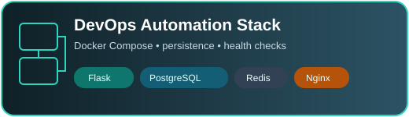</a>

**DevOps Automation Stack**

A Docker Compose environment with Flask, PostgreSQL, Redis and Nginx.

- Multi-container orchestration and persistent storage.
- Health checks and service dependencies.
- Backup/restore and automation scripts.

<a href="https://github.com/mhmdhmdbdh2050/docker-compose-wordpress-stack">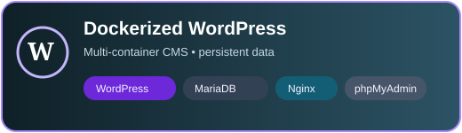</a>

**Dockerized WordPress Stack**

A WordPress environment using Docker Compose, MariaDB, Nginx and phpMyAdmin.

<a href="https://github.com/mhmdhmdbdh2050/Docker-networking-lab">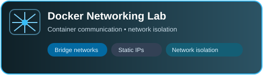</a>

**Docker Networking Lab**

A practical lab covering bridge networks, network isolation, static IPs and multi-network containers.

### More Projects

- [Docker Custom Image](https://github.com/mhmdhmdbdh2050/Docker-custom-image-project) — Dockerfile, custom Nginx image, and port mapping.
- [Docker Volume Project](https://github.com/mhmdhmdbdh2050/Docker-volume-project) — persistent storage.
- [Simple Docker Project](https://github.com/mhmdhmdbdh2050/Simple_docker_project) — serving a website from a container.
- [Rock Paper Scissors Game](https://github.com/mhmdhmdbdh2050/Rock-paper-and-scissors-game) — Python command-line game.

### Project Architecture Maps

Each architecture image links to the corresponding repository.

<a href="https://github.com/mhmdhmdbdh2050/devops-automation-stack">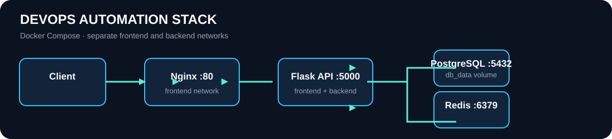</a>

<a href="https://github.com/mhmdhmdbdh2050/k8s-multi-app-ingress-lab">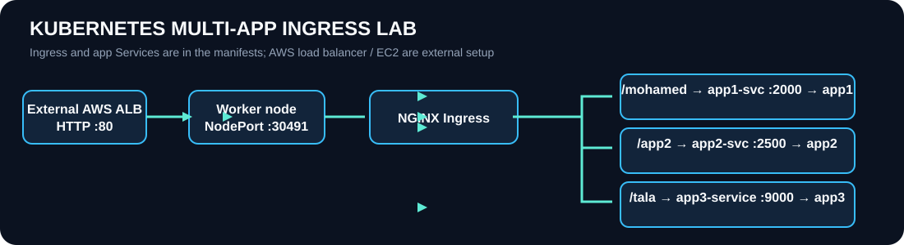</a>

<a href="https://github.com/mhmdhmdbdh2050/docker-compose-wordpress-stack">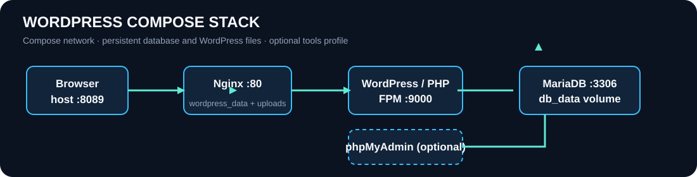</a>

<a href="https://github.com/mhmdhmdbdh2050/Docker-networking-lab">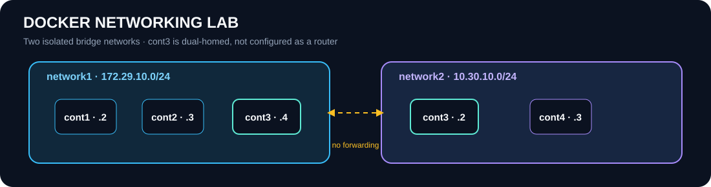</a>

<a href="https://github.com/mhmdhmdbdh2050/Docker-custom-image-project">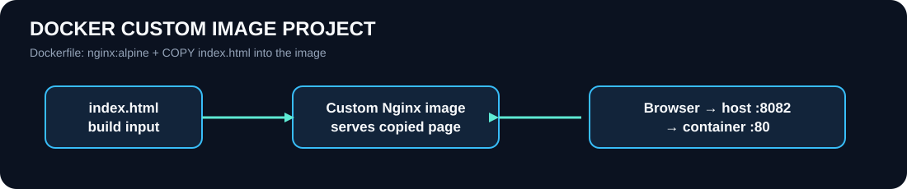</a>

<a href="https://github.com/mhmdhmdbdh2050/Docker-volume-project">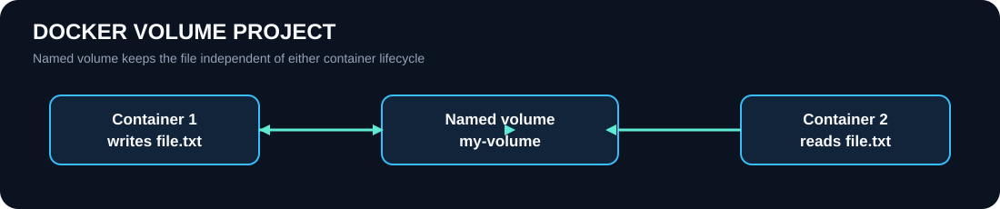</a>

<a href="https://github.com/mhmdhmdbdh2050/Simple_docker_project">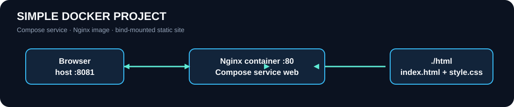</a>

<a href="https://github.com/mhmdhmdbdh2050/Rock-paper-and-scissors-game">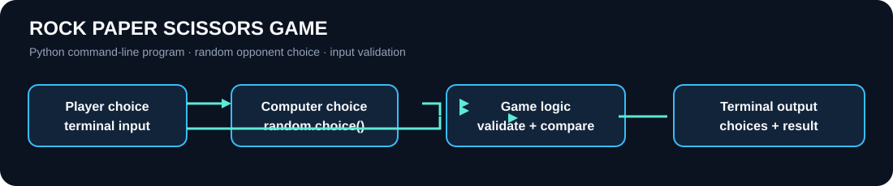</a>

## `06` — GitHub Telemetry

*Statistics and third-party widgets are supplied by external services and may occasionally be unavailable or delayed.*

## `07` — Education

**Cairo University — Faculty of Commerce**

Graduated: 2026

## `08` — Establish Connection

- **Email:** [ahmedmohamed05147@gmail.com](mailto:ahmedmohamed05147@gmail.com)
- **LinkedIn:** [Connect with me](https://www.linkedin.com/in/mohamed-ahmed-6705b3303/)
- **GitHub:** [@mhmdhmdbdh2050](https://github.com/mhmdhmdbdh2050)

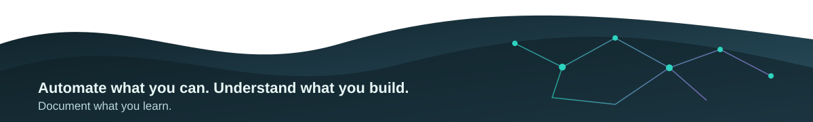

