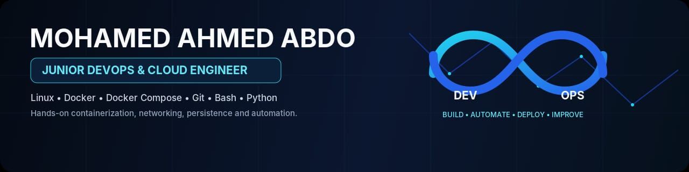
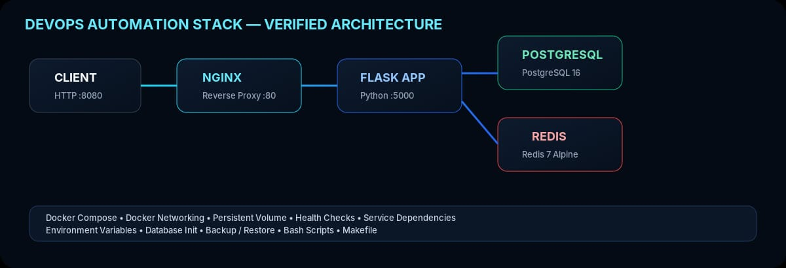

# Mohamed Ahmed Abdo
### Junior DevOps & Cloud Engineer

**Building infrastructure. Automating workflows. Learning by doing.**

---

## 👋 About me

I'm **Mohamed Ahmed Abdo**, a Junior DevOps & Cloud Engineer based in **Giza, Egypt**. I learn by building and troubleshooting practical environments, from Docker-based application stacks to Kubernetes deployments and ingress routing.

My focus is on understanding how infrastructure components communicate, how applications stay available, how data persists, and how repeatable workflows reduce manual effort.

- 🎯 **Target roles:** Junior DevOps Engineer · Junior Cloud Engineer
- 🧰 **Core focus:** Linux, Docker, Kubernetes, automation, networking, AWS fundamentals
- 📚 **Approach:** Build → Test → Troubleshoot → Document → Improve
- 🤝 **Open to:** Junior opportunities, collaboration, and technical feedback

## 🧰 Technical toolkit

<table>
<tr>
<td width="50%" valign="top">

### 🐧 Linux & automation
- Linux / Ubuntu administration
- Bash scripting and Python fundamentals
- Git and GitHub workflows

### 🐳 Containers
- Docker and Dockerfiles
- Docker Compose
- Container lifecycle and health checks
- Volumes, bridge networks, service discovery

</td>
<td width="50%" valign="top">

### ☸️ Kubernetes
- Pods, Deployments, and Services
- ConfigMaps and Secrets fundamentals
- Ingress and path-based routing
- Jobs, CronJobs, and DaemonSets
- Node selectors, affinity, and taints
- Rolling updates and rollbacks

### ☁️ Cloud & networking
- AWS cloud fundamentals: EC2, S3, VPC, IAM
- TCP/IP, DNS, HTTP/HTTPS, SSH
- Nginx reverse proxy fundamentals

</td>
</tr>
</table>

**Application and data services:** `Flask` · `PostgreSQL` · `MariaDB` · `Redis` · `WordPress` · `Nginx`

> These reflect my current skills and hands-on learning. The projects below show where I have practised specific implementations; I do not present learning labs as production experience.

---

## 🚀 Featured projects

### 01 · Kubernetes Multi-App Ingress Lab

A multi-application Kubernetes lab for practising workload deployment and exposing services through NGINX Ingress path-based routing.

**Highlights**
- Kubernetes Deployments and Services
- NGINX Ingress routing
- Multi-node cluster practice on AWS EC2
- Flannel networking and troubleshooting
- Workload and scheduling concepts

**Repository:** [Explore the Kubernetes lab →](https://github.com/mhmdhmdbdh2050/k8s-multi-app-ingress-lab)

---

### 02 · DevOps Automation Stack

A containerized application stack connecting a Flask backend with PostgreSQL, Redis, and Nginx through Docker Compose.

**Highlights**
- Multi-service Docker Compose orchestration
- PostgreSQL persistence and initialization
- Redis integration and Nginx reverse proxy
- Health checks and service dependencies
- Environment-based configuration
- Backup/restore and health-check scripts
- Makefile automation

**Repository:** [Explore the DevOps Automation Stack →](https://github.com/mhmdhmdbdh2050/devops-automation-stack)

---

### 03 · Dockerized WordPress Stack

A multi-container WordPress environment for practising service separation, networking, and persistent application data.

**Stack:** WordPress · MariaDB · Nginx · phpMyAdmin · Docker networks · Volumes

**Repository:** [Explore the WordPress stack →](https://github.com/mhmdhmdbdh2050/docker-compose-wordpress-stack)

---

### 04 · Docker Networking Lab

A hands-on lab exploring how Docker containers communicate and how custom networks provide isolation.

**Focus:** Custom bridge networks · Container communication · Network isolation · Static IP addressing · Multi-network containers

**Repository:** [Explore the networking lab →](https://github.com/mhmdhmdbdh2050/Docker-networking-lab)

---

### More projects

| Project | What it explores | Link |
|---|---|---|
| Docker Custom Image | Dockerfile, custom Nginx image, port mapping | [View repository](https://github.com/mhmdhmdbdh2050/Docker-custom-image-project) |
| Docker Volume Project | Persistent container storage | [View repository](https://github.com/mhmdhmdbdh2050/Docker-volume-project) |
| Simple Docker Project | Serving a website from a container | [View repository](https://github.com/mhmdhmdbdh2050/Simple_docker_project) |

---

## 🎓 Education

**Cairo University — Faculty of Commerce**  
Graduated: 2026

## 🏅 AWS Certifications

| Certification | Issued | Expires | Verification |
|---|---|---|---|
| **AWS Certified AI Practitioner** | September 10, 2026 | September 10, 2029 | [AWS Certification Verification](https://aws.amazon.com/verification/) |
| **AWS Certified Cloud Practitioner** | May 25, 2026 | May 25, 2029 | [AWS Certification Verification](https://aws.amazon.com/verification/) |

*To verify a credential, use the validation number printed on the corresponding certificate on the official AWS verification page.*

---

## 📬 Let's connect

I'm interested in junior DevOps / Cloud opportunities and connecting with engineers who enjoy practical problem-solving.

**Build → Test → Troubleshoot → Document → Improve**

